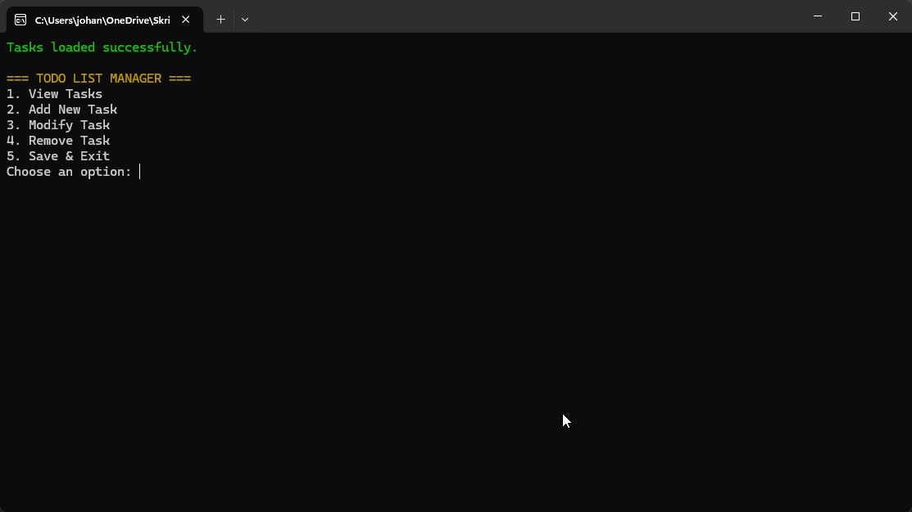
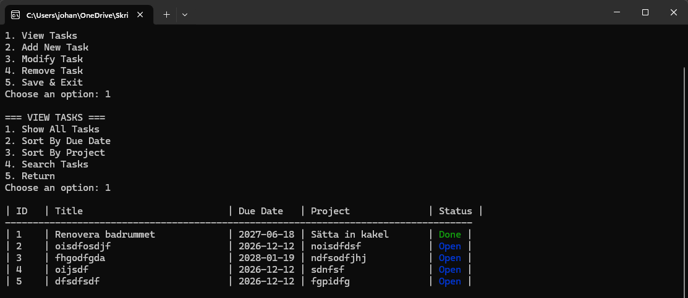
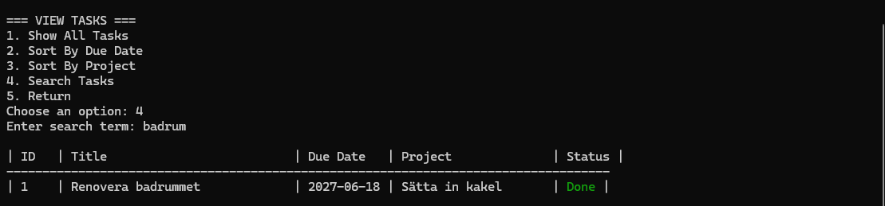
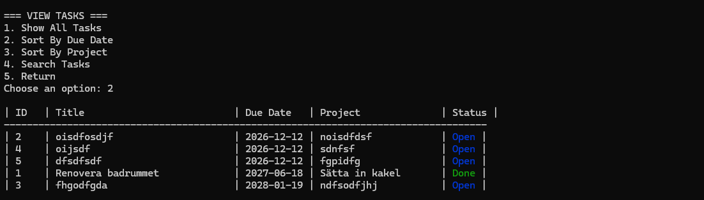

# Todo List Manager

## Project Description

Todo List Manager is a C# console application designed to help users organize and manage tasks efficiently.

Users can create tasks, assign a due date and project category, update existing tasks, mark tasks as completed, remove tasks, search for tasks, and save their progress between sessions.

The application automatically stores task data in a JSON file and restores the previous state when the program is restarted.

---

## Features

- Create new tasks
- Assign titles, due dates, and projects
- View all tasks
- Sort tasks by due date
- Sort tasks by project
- Search for tasks
- Modify existing tasks
- Mark tasks as completed
- Delete tasks
- Save tasks to a JSON file
- Restore previous application state on startup
- User-friendly validation and error handling

---

## Technologies

- C#
- .NET
- Console Application
- LINQ
- JSON Serialization (`System.Text.Json`)

---

## Installation

1. Clone the repository:

```bash
git clone https://github.com/lorriluring/TodoListManager.git
```

2. Open the solution in Visual Studio.

3. Build the project.

4. Run the application.

---

## How to Run

Start the program from Visual Studio or use:

```bash
dotnet run
```

Main Menu:

```text
1. View Tasks
2. Add New Task
3. Modify Task
4. Remove Task
5. Save & Exit
```

---

## Screenshots

### Main Menu



### View Tasks



### Search Tasks



### Sort by Date



### JSON Save File


---

## Team Members

### Johan Lorentz

- Project Planning
- Design
- Development
- Testing
- Documentation

GitHub Profile:
([Add your GitHub profile link here](https://github.com/lorriluring))

---

## Future Improvements

Potential future improvements include:

- Task priority levels
- Task descriptions
- Filtering completed and incomplete tasks
- Multiple user profiles
- Export to CSV
- Export to PDF
- GUI version using WPF or WinForms
- Statistics and reporting features

---

## Project Structure

```text
TodoListManager
│
├── Data
│   └── tasks.json
│
├── Models
│   └── TaskItem.cs
│
├── Services
│   └── TaskManager.cs
│
└── Program.cs
```

---

## Design Principles

The primary design goal of this project was usability.

Every action performed by the user should either succeed or provide a clear and helpful error message. The application guides users through menus, validates input, provides examples when errors occur, and minimizes the amount of technical knowledge required to use the system.

The project follows a separation-of-responsibilities architecture:

- `TaskItem` represents task data.
- `TaskManager` handles task-related operations.
- `Program.cs` manages user interaction and navigation.
